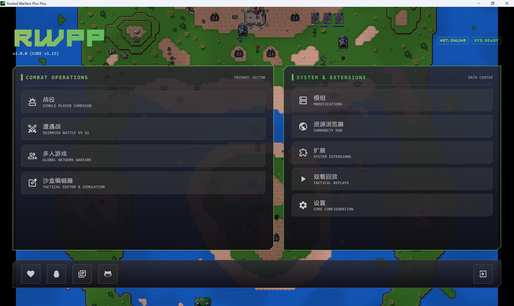

<div align="center">
<h1> RWPP </h1>
<div align="center">
  <strong>multiplatform launcher for Rusted Warfare</strong>
</div>
<br />
<div align="center">
 
</div>
<br />

----
[](http://kotlinlang.org)
[](https://www.jetbrains.com/lp/compose-multiplatform/)


[]()
[]()
</div>

<h1 align="center"> Screenshot </h1>



<h1 align="center"> Implemented </h1>

 - __Ban Units__
 - __IME fixed__
 - __Blacklists__
 - __List filter__
 - __More room options__ (Such as lock room and team look)
 - __External Resource__
 - __New UI__

<h1 align="center"> Download </h1>

You can download RWPP release version in the releases.

<h1 align="center"> Run </h1>

RWPP must be installed into (or run from) your **Rusted Warfare game root** so it can load `game-lib.jar`, assets, and platform natives (`java.library.path=.`).

## Msi Version (Windows)
- Install RWPP to your rw root directory
> e.g. SteamLibrary\steamapps\common\Rusted Warfare\
- Run RWPP.exe

## Jar Version (Windows)
- Install Java 17
- Copy RWPP.jar to your rw root directory.
> e.g. SteamLibrary\steamapps\common\Rusted Warfare\
- Run launcher.bat

## macOS (Jar / DMG)

### Requirements
- Steam **macOS** build of [Rusted Warfare](https://store.steampowered.com/app/647960/Rusted_Warfare__RTS/)
- **OpenJDK 17+**
- On **Apple Silicon**: use an **x86_64 JDK under Rosetta** by default. Official LWJGL2 / OpenAL / JInput natives shipped with RW are Intel-only. Native arm64 community natives are experimental and not bundled.

### Jar
1. Copy the uber-jar (`RWPP-macos.jar`) and `launcher.sh` into the RW game directory  
   (e.g. `~/Library/Application Support/Steam/steamapps/common/Rusted Warfare/`).
2. Ensure the game root contains macOS natives such as `liblwjgl.dylib`, `openal.dylib` / `libopenal.dylib`, and `libjinput-osx.*`.
3. `chmod +x launcher.sh && ./launcher.sh`

On macOS, `./gradlew :rwpp-desktop:packageReleaseUberJarForCurrentOS` writes  
`rwpp-desktop/build/compose/jars/RWPP-macos.jar`.

### DMG
1. On a Mac, build with `./gradlew :rwpp-desktop:packageDmg` (or use a release DMG).
2. Copy the app contents into the RW game root so `java.library.path` still points at the game natives, **or** keep the app next to those dylibs and launch from that directory.
3. Prefer Skiko **Default (Metal)** for the Compose UI (RWPP overrides OpenGL→Metal on macOS automatically). In-game rendering still uses LWJGL2 OpenGL.

### Steam on macOS
Use [`steam-macos.sh`](steam-macos.sh) as an optional launch wrapper (does **not** use the Windows WiX/`Rusted Warfare - 64.exe` flow):

```bash
cp steam-macos.sh "/path/to/Rusted Warfare/"
chmod +x "/path/to/Rusted Warfare/steam-macos.sh"
```

Then run `steam-macos.sh` from the game directory, or point Steam launch options at it. See comments inside the script for packaging (`RWPP.app`) vs jar layouts.

## Linux (Jar)
- Install Java 17
- Copy the jar + `launcher.sh` into the RW root
- `chmod +x launcher.sh && ./launcher.sh`

<h1 align="center"> Build </h1>

- Use OpenJdk 17 or above.
- For desktop uber-jar (current OS): `./gradlew :rwpp-desktop:packageReleaseUberJarForCurrentOS`
- For macOS DMG (must run on macOS): `./gradlew :rwpp-desktop:packageDmg`
- For Linux Deb (must run on Linux): `./gradlew :rwpp-desktop:packageDeb`
- To build msi, run task `rwpp-desktop:packageWixDistribution` (Windows + .NET SDK)
- For android, assets and res are missing for some reason, you can find them in your Rusted Warfare client.

### macOS architecture note
When developing or packaging on Apple Silicon for real gameplay, prefer building/running with an **x86_64 JDK** so the process matches official RW natives:

```bash
arch -x86_64 /path/to/jdk-17-x64/bin/java -version
# then use that JDK with Gradle, e.g.
export JAVA_HOME=/path/to/jdk-17-x64
./gradlew :rwpp-desktop:run
```

Static checks (scripts, packaging flags, docs) without a full RW install:

```bash
./scripts/verify-macos-compat.sh
```

<h1 align="center"> Contribute </h1>

If you find any bugs or have any suggestions, please create an issue.

<h1 align="center"> Thanks </h1>

[RW-HPS](https://github.com/deng-rui/RW-HPS)
